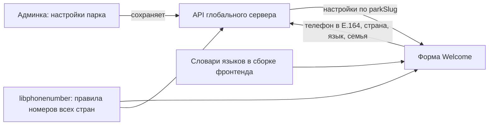

# Международная форма регистрации: настройки и масштабирование

Прототип: `guest-registration/international.html?park=<id>`. Страница настроек с предпросмотром: `guest-registration/international-settings.html`.

## Идея

Одна форма для всех стран. Отличия между парками описываются настройками парка, а не отдельными копиями HTML. Новая страна запускается добавлением записи в настройки; новый язык добавляется словарём.

Это продолжение [ТЗ Welcome](ТЗ_Welcome_отдельный_фронтенд_регистрации.md): там форма получает опубликованные настройки парка из API глобального сервера, а сотрудники меняют их в админке. Языки и код страны становятся двумя разделами этих настроек.



## Настройки парка

```json
{
  "id": "dubai",
  "name": { "en": "Hello Park Dubai", "ar": "Hello Park دبي" },
  "languages": { "available": ["en", "ar"], "default": "en" },
  "phone": {
    "selectable": true,
    "defaultCountry": "AE",
    "priorityCountries": ["AE", "OM", "SA", "QA", "KW", "BH", "IN", "PK", "PH", "GB", "RU"],
    "allowedCountries": null
  },
  "legal": { "rulesUrl": "https://…", "privacyUrl": { "en": "https://…", "ar": "https://…" } }
}
```

| Поле | Что делает |
|---|---|
| `languages.available` | Языки, между которыми гость переключается. Один язык — переключатель скрыт. |
| `languages.default` | Язык при первом открытии. |
| `phone.selectable` | `false` закрепляет код страны: гость не может его сменить, номера других стран не принимаются. |
| `phone.defaultCountry` | Страна по умолчанию, код ISO (`AE`, `OM`, `PE`, `RU`). |
| `phone.priorityCountries` | Страны в начале списка; остальные идут по алфавиту на языке гостя. |
| `phone.allowedCountries` | Необязательное ограничение списка стран; по умолчанию доступны все. |
| `legal.*Url` | Ссылки на правила и обработку данных для текста согласия по умолчанию; строка или объект по языкам. |
| `consentText` | Необязательно: свой текст согласия по языкам. Ссылки пишутся как `[правила парка](https://…)`. Если для языка текста нет, гость видит стандартный текст из словаря со ссылками `legal.*Url`. |

Страну храним как ISO-код, а не как телефонный код: `+1` общий у США и Канады, `+7` — у России и Казахстана.

## Стартовые конфигурации

| Парк | Языки | По умолчанию | Код страны |
|---|---|---|---|
| Дубай | английский, арабский | английский | ОАЭ +971, можно сменить |
| Оман | английский, арабский | английский | Оман +968, можно сменить |
| Лима | испанский, английский | испанский | Перу +51, можно сменить |
| Селигерская (пример) | русский | русский | Россия +7, закреплён |

В Перу официальный и основной язык — испанский. В ОАЭ и Омане интерфейс пишем на литературном арабском (фусха); разговорный диалект в письменных формах не используют.

## Как форма выбирает язык

1. `?lang=` в ссылке, если язык включён у парка.
2. Язык, который гость выбрал раньше в этом парке (хранится в браузере).
3. `languages.default` парка.

Автоматическое определение по языку телефона не включено. Его можно добавить вторым пунктом, если захотим, чтобы туристы сразу видели свой язык.

## Телефон

Номера проверяет библиотека [libphonenumber-js](https://gitlab.com/catamphetamine/libphonenumber-js) (метаданные Google libphonenumber): формат при вводе, список из 245 стран с названиями на языке гостя, проверка мобильного номера. Таблицу масок вручную не ведём. Сборка `mobile` принимает только мобильные номера, поэтому городской номер Омана `24…` форма отклонит.

Страну гость выбирает в выпадающем списке с поиском: по названию на своём языке, по английскому названию или по коду (`+51`, `971`). Сверху стоят страны из `priorityCountries`, ниже — все остальные по алфавиту.

Номер в поле пишется слева направо вместе с кодом страны, и в арабской версии тоже. Так его показывают и арабские интерфейсы: цифры внутри арабского текста читаются слева направо, а номер должен совпадать с тем, как гость видит его в своём телефоне.

Вставленный номер с `+` сам переключает страну, если выбор страны разрешён. Номер уходит на сервер в формате E.164 (`+971501234567`) вместе с ISO-кодом страны. Сервер должен проверять номер той же библиотекой (для Node.js — `libphonenumber-js`, для Python — `phonenumbers`), потому что проверка в браузере не защищает от прямых запросов.

## Языки и арабский

Словари лежат в `guest-registration/international/i18n.js`. Новый язык — новый объект с теми же ключами; недостающие строки берутся из английского. Для арабского `_meta.dir = 'rtl'`: страница переворачивается справа налево, стрелки кнопок отражаются, шрифт Tajawal. Номер телефона и даты всегда пишутся слева направо.

В рабочей версии переводы, которые меняются часто (приветствие, экран успеха, тексты согласий), стоит редактировать в админке поверх словаря по умолчанию, как описано в ТЗ Welcome.

## Как запустить новую страну

1. Проверить, есть ли нужный язык в словарях; если нет — добавить словарь и отдать на вычитку носителю.
2. Создать настройки парка: языки, язык по умолчанию, страна и разрешение её менять, приоритетные страны, ссылки на правила и обработку данных на каждом языке.
3. Проверить форму на странице настроек и пройти регистрацию на телефоне.

Изменения кода нужны только для нового типа поля или нового правила проверки.

## Что нужно до запуска

- Вычитка арабских и испанских текстов носителями. Сейчас это рабочий перевод.
- Ссылки на правила и политику данных для Дубая, Омана и Лимы на каждом языке. Сейчас стоят заглушки `hello-park.com`.
- Поля в CRM и базе для страны телефона и языка гостя, хранение телефона в E.164.
- Отправка анкеты на сервер. Прототип собирает данные (`window.HP_LAST_REGISTRATION`), но никуда их не отправляет.
- Адреса в формате ТЗ Welcome: `welcome.hello-park.io/<парк>` вместо `?park=`.

## Проверка

`node scripts/test_international_form.mjs` при запущенном `python3 -m http.server 4173 --bind 127.0.0.1` из корня проекта. Тест проходит Дубай на английском и арабском, Оман, Лиму, парк с закреплённым кодом, неизвестный парк, ширину 320 и 390 px и страницу настроек.

